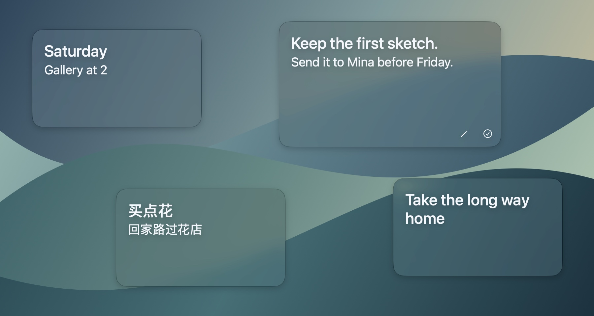

# GlassNotes

[简体中文](README.zh-CN.md)

GlassNotes is a native macOS menu bar app for short notes that live on your desktop. Each note is a separate pane of frosted glass. Arrange a few where you want them, glance at them between windows, and wipe them away when you're done.



## Install

GlassNotes runs on macOS 14 or later. Desktop notes default to an AppKit frosted backdrop that keeps its appearance when keyboard focus moves. On macOS 26 or later, you can switch desktop notes to Liquid Glass to see its refraction and focus transitions. On macOS 26 and later, the menu bar panel and undo notification use native Liquid Glass. The app interface is currently in Simplified Chinese.

If you have a GlassNotes DMG, open it and drag **GlassNotes.app** into **Applications**. The architecture is in the DMG filename. Choose `arm64` for Apple silicon. When upgrading, quit the running copy first. Your notes carry over automatically.

## Use GlassNotes

| Action | How |
| --- | --- |
| Capture | Click the handwritten mark in the menu bar or press **⌃⌥N**. Enter a note and press **⌘↩** to place it on the desktop. |
| Arrange | Drag the text, edge, or open area of a note. Regular app windows sit above your notes. |
| Edit | Hover over the note and click the pencil in the lower-right corner. Press **⌘↩** to save or **Esc** to cancel. |
| Complete and restore | Click the circled checkmark. The text wipes away and the glass fades. Undo within five seconds, or restore it later from **已完成** in the menu bar panel. |
| Permanently delete | In **已完成**, click the trash icon next to a note, then confirm **永久删除**. |
| Check the version | Open **…** in the menu bar panel. The installed app shows its version just above **退出 GlassNotes**. |
| Adjust the glass | Open **… → 玻璃透明度**. On macOS 26 or later, turn on **使用原生 Liquid Glass** to switch all notes immediately. Turn it off to return to your saved frosted settings. For frosted glass, choose a starting preset. Drag **材质强度** (material strength, 20–100%) and **背景压暗** (background dimming, 0–62%) to update every note live. Use **恢复** to restore the selected preset. Reduce Transparency and Reduce Motion follow macOS accessibility settings. |

To set a global capture shortcut, open **… → 快速记录快捷键 → 录制快捷键** and press the combination. Use Command, Option, or Control with a key, or use a function key on its own. Press Esc to cancel. The **预设** menu restores a preset or turns the shortcut off.

## Local storage

GlassNotes works offline. It stores note text, completion history, and desktop positions in `~/Library/Application Support/GlassNotes/notes.json`. Quit GlassNotes before copying or restoring that file. Appearance and shortcut preferences use macOS user defaults.

## Build from source

Install a Swift 6.2 or later toolchain with the macOS 26 SDK or later, plus Python 3 for the design checks. From the repository root run:

```sh
make app
open dist/GlassNotes.app
```

| Command | Purpose |
| --- | --- |
| `make check` | Check formatting and design conventions, then run the unit tests. |
| `make smoke` | Exercise native windows in a logged-in Mac desktop session. |
| `make fmt` | Format Swift sources. |
| `make dmg` | Build the app and create a drag-to-install disk image in `dist/` for the build machine's architecture. |

Local builds use an ad hoc signature. For public binary distribution, sign with Developer ID and notarize the disk image. [Apple's distribution guide](https://developer.apple.com/documentation/xcode/packaging-mac-software-for-distribution)

## Contributing

Keep storage and layout logic in [NoteCore](Sources/NoteCore), visual tokens and components in [NoteDesign](Sources/NoteDesign), and windows and menu interactions in [GlassNotes](Sources/GlassNotes). Before submitting a change, run `make check` and, for window interactions, `make smoke`. See the [architecture](docs/architecture.md), [design system](docs/design-system.md), and [repository conventions](AGENTS.md).

## License

[MIT License](LICENSE). GlassNotes renders text through the macOS system font APIs. The app package contains no font binaries.
