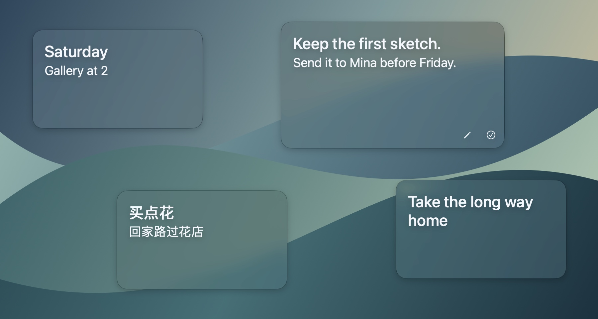

# GlassNotes

[English](README.md)

GlassNotes 是一款原生 macOS 菜单栏便签。每张便签都是一块独立的毛玻璃。把几张便签散放在桌面，切回桌面时一眼就能看到，做完一件就擦掉一张。



## 安装

支持 macOS 14 及以上。桌面便签使用焦点切换时亮度稳定的 AppKit 毛玻璃，macOS 26 及以上的菜单栏面板和撤销提示使用原生 Liquid Glass。当前应用界面为简体中文。

如果已取得 GlassNotes 的 DMG，双击打开，将 **GlassNotes.app** 拖入「应用程序」。文件名会标出架构，Apple 芯片的 Mac 选择 `arm64`。升级前先退出正在运行的旧版，原有便签会自动沿用。

## 使用

| 操作 | 方法 |
| --- | --- |
| 快速记录 | 点菜单栏的手写笔迹图标，或按 **⌃⌥N**。输入内容后按 **⌘↩** 贴到桌面。 |
| 移动 | 在正文、边缘或空白处按住拖动即可。普通应用窗口位于便签上方。 |
| 编辑 | 指针移入便签，点右下角的铅笔。按 **⌘↩** 保存，按 **Esc** 取消。 |
| 完成与恢复 | 点圆圈勾，文字会擦去，玻璃随之淡出。五秒内可点「撤销」，之后仍可在菜单栏的「已完成」列表恢复。 |
| 永久删除 | 在「已完成」里点击便签旁的垃圾桶，核对内容后点「永久删除」。 |
| 调整透明度 | 打开 **… → 玻璃透明度**，从「通透」「标准」「低透」中选一个预设，再连续调节材质强度（20–100%）和背景压暗（0–62%）。所有便签实时更新，点「恢复」可回到所选预设。「减少透明度」和「减少动态效果」跟随 macOS 辅助功能设置。 |

打开「… → 快速记录快捷键 → 录制快捷键」，按下想用的组合键。可使用 ⌘、⌥ 或 ⌃ 搭配其他键，也可单独使用功能键。按 Esc 取消，在「预设」里可恢复预设或关闭快捷键。

## 本地存储

GlassNotes 可离线使用。正文、完成记录和桌面位置保存在 `~/Library/Application Support/GlassNotes/notes.json`。备份或恢复这个文件前请先退出应用。外观和快捷键使用 macOS 偏好设置保存。

## 从源码构建

需要 Swift 6.2 或更新工具链、macOS 26 或更新 SDK，以及用于设计检查的 Python 3。在仓库根目录运行：

```sh
make app
open dist/GlassNotes.app
```

| 命令 | 用途 |
| --- | --- |
| `make check` | 检查格式与设计规范，并运行单元测试。 |
| `make smoke` | 在已登录的 Mac 图形桌面中运行原生窗口测试。 |
| `make fmt` | 格式化 Swift 源码。 |
| `make dmg` | 按构建机器架构打包应用，在 `dist/` 生成可拖入安装的镜像。 |

本地构建使用临时签名。公开分发二进制版本时，应使用 Developer ID 签名并对镜像进行公证。[Apple 分发指南](https://developer.apple.com/documentation/xcode/packaging-mac-software-for-distribution)

## 参与开发

存储与布局逻辑位于 [NoteCore](Sources/NoteCore)，视觉 token 和组件位于 [NoteDesign](Sources/NoteDesign)，桌面窗口及菜单交互位于 [GlassNotes](Sources/GlassNotes)。提交改动前运行 `make check`，涉及窗口交互时再运行 `make smoke`。更多约定见[技术方案](docs/architecture.md)、[设计系统](docs/design-system.md)和[仓库开发规范](AGENTS.md)。

## 许可证

项目采用 [MIT 许可证](LICENSE)。GlassNotes 通过 macOS 系统字体 API 渲染文字，安装包不包含字体文件。
